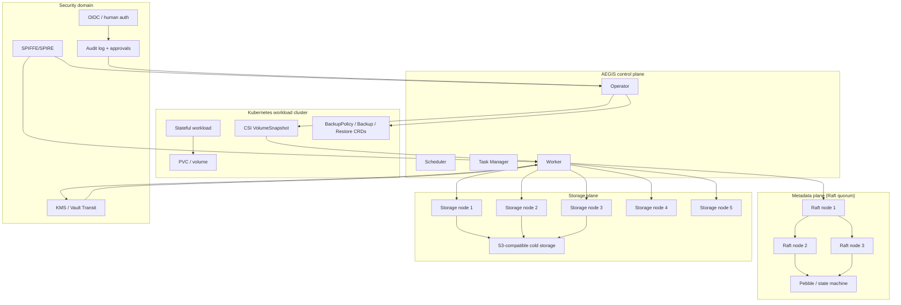
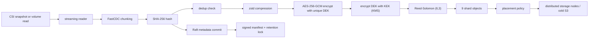
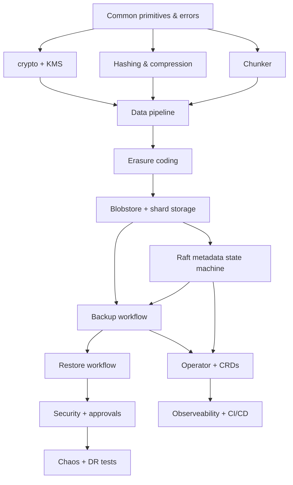

# AEGIS: Immutable Distributed Data Protection Platform for Kubernetes
## Master Implementation Plan

This document is the execution blueprint for building AEGIS as a practical, deployable, Kubernetes-native backup and disaster-recovery platform. It is written for a single engineer over roughly 13 months, with a strict dependency order, proof-oriented milestones, and engineering checklists that can be executed directly in an IDE.

> Primary design mandate:
> A compromise of the Kubernetes control plane, workload identity, or cluster administrative domain must not automatically allow an attacker to delete, alter, or silently corrupt protected backup data or its metadata.

---

## 1. Project overview

AEGIS is a zero-trust backup and recovery platform designed for stateful workloads in Kubernetes. It protects against ransomware, administrative compromise, cluster takeover, storage corruption, and data loss while preserving an immutable, auditable backup lineage.

The platform is built around four trust anchors:

1. The data plane stores encrypted, content-addressed chunks and erasure-coded shards in a distributed storage fabric.
2. The metadata plane uses a strongly consistent Raft cluster to track snapshots, chunk locations, retention locks, task state, and restore history.
3. The control plane uses a Kubernetes operator and CRDs to schedule backups, manage snapshot lifecycle, and enforce policy.
4. The security plane enforces workload identity, external KMS access, dual approval for destructive actions, and signed manifests for restore verification.

The implementation must not be a generic roadmap. It must produce a working system in stages. This plan prioritizes the data-plane primitives first, then Raft metadata, then operator orchestration, then restore, security, and finally chaos/drill testing.

### Required project capabilities

- Kubernetes-native backup policies
- Scheduled backups
- Application-consistent backup hooks
- CSI VolumeSnapshot integration
- Content-defined chunking (FastCDC)
- SHA-256 integrity validation
- Deduplication
- zstd compression
- AES-256-GCM encryption with a unique DEK per chunk
- Envelope encryption using KMS KEK
- Reed-Solomon (6,3) erasure coding
- Multi-node shard placement and repair
- Strongly consistent metadata via Raft
- Immutable retention
- Dual approval for destructive retention operations
- Signed snapshot manifests
- Restore verification before data is exposed
- Operator-driven orchestration and retry semantics
- Supply-chain security with SBOM, signing, provenance, transparency log
- GitOps deployment, admission policy enforcement, observability
- Chaos testing and DR validation

---

## 2. Architecture first

### 2.1 Logical architecture

AEGIS is split into five security domains and trust boundaries:

1. Workload domain
   - Application pods, StatefulSets, PVCs, CSI snapshot APIs
   - Untrusted from a backup-security perspective
2. Control plane domain
   - AEGIS Operator, Scheduler, Task Manager, and Reconcile loops
   - Trusted enough to issue snapshot and restore commands, but not able to delete immutable backup storage
3. Metadata domain
   - Raft node cluster that stores snapshot metadata, chunk index, shard locations, retention locks, and task state
   - Must remain strongly consistent and quorum-backed
4. Storage domain
   - Worker nodes and blob storage nodes
   - Receives encrypted, erasure-coded shards and persists them in object storage or local block storage
5. Security domain
   - SPIRE, OIDC, KMS, signature verification service, approval workflow, signing keys, audit log

### 2.2 Component architecture



### 2.3 Data flow



### 2.4 Backup flow

1. `BackupPolicy` CR is created or scheduled.
2. Operator resolves target workloads and PVCs.
3. Operator creates a `Backup` CR and worker task lease.
4. Pre-backup hooks are executed inside the workload or sidecar.
5. Worker requests a CSI `VolumeSnapshot` for the target PVC.
6. Worker creates a temporary read-only mount or reads the snapshot data stream.
7. Data is chunked, hashed, deduplicated, compressed, encrypted, and erasure-coded.
8. Shards are written to storage nodes; metadata is committed to Raft.
9. Snapshot manifests are signed and sealed.
10. Post-backup hooks are run; backup is marked `Completed`.
11. Retention lock and policy checks are enforced.

### 2.5 Restore flow


### 2.6 Metadata flow

Metadata is the source of truth for backup visibility, chunk references, retention state, and restore admission. All metadata operations require quorum commit. A snapshot is not visible to restore until the Raft log entry is replicated and durably committed.

Key data:

- snapshot metadata
- chunk index
- shard locations
- task state
- retention information
- key metadata
- audit events
- tenant and policy metadata

### 2.7 Failure-recovery flow

Recovery actions are part of the design rather than afterthoughts.

- Worker crash: reassign backup task and resume from last checkpoint
- Storage node failure: reconstruct missing shards with RS parity
- Metadata leader crash: follower election and retries
- KMS outage: fail-safe backup operations are blocked; no plaintext keys are stored
- Network partition: majority quorum continues; minority rejects writes
- Partial restore: fail closed; no corrupted chunk is returned
- Interrupted backup: resumable chunk writes and metadata checkpoints allow restart without duplication

### 2.8 Security boundaries and trust boundaries

Important boundaries:

- Workload domain is not trusted to read backup metadata or delete storage
- Control plane can create tasks but cannot directly modify immutable storage without a policy and approval workflow
- Metadata plane is a trusted quorum; it governs a small, auditable state machine
- Storage plane is encrypted and logically isolated; raw shard deletion is not permitted directly by workloads
- Security domain is separate from workload and Kubernetes admin domains

Trust assumptions:

- KMS and SPIRE are trusted authorities
- OIDC identity is used for dual approval and human admin actions
- Kubernetes RBAC, Node authorizations, and service account identity are gating controls, not the primary end-to-end security engine

---

## 3. Repository structure

The repository should be organized according to subsystem responsibilities, not by product surface only.

```text
AEGIS/
├── .github/
│   ├── workflows/
│   │   ├── ci.yml
│   │   ├── integration.yml
│   │   ├── security.yml
│   │   ├── sbom.yml
│   │   ├── release.yml
│   │   ├── provenance.yml
│   │   └── deploy.yml
│   └── CODEOWNERS
├── api/
│   ├── v1alpha1/
│   │   ├── backup_policy.go
│   │   ├── backup.go
│   │   ├── restore.go
│   │   └── zz_generated.deepcopy.go
│   └── docs/
├── cmd/
│   ├── aegis-operator/
│   │   └── main.go
│   ├── aegis-worker/
│   │   └── main.go
│   ├── aegis-metadata/
│   │   └── main.go
│   ├── aegis-storage/
│   │   └── main.go
│   └── aegis-cli/
│       └── main.go
├── config/
│   ├── crd/
│   │   ├── bases/
│   │   └── kustomization.yaml
│   ├── rbac/
│   │   ├── role.yaml
│   │   ├── role_binding.yaml
│   │   └── service_account.yaml
│   ├── security/
│   │   ├── kyverno/
│   │   ├── opa/
│   │   └── spire/
│   ├── helm/
│   │   └── aegis/
│   └── manifests/
│       └── deployment.yaml
├── docs/
│   ├── architecture.md
│   ├── runbooks/
│   ├── security.md
│   ├── testing.md
│   ├── observability.md
│   └── implementation-plan.md
├── internal/
│   ├── blobstore/
│   │   ├── interface.go
│   │   ├── filesystem.go
│   │   ├── s3.go
│   │   ├── local_test.go
│   │   └── metrics.go
│   ├── chunker/
│   │   ├── fastcdc.go
│   │   ├── reader.go
│   │   ├── benchmark_test.go
│   │   └── chunker_test.go
│   ├── crypto/
│   │   ├── hash.go
│   │   ├── compress.go
│   │   ├── encrypt.go
│   │   ├── keystore.go
│   │   ├── signing.go
│   │   └── crypto_test.go
│   ├── dedup/
│   │   ├── index.go
│   │   ├── refcount.go
│   │   ├── dedup_test.go
│   │   └── benchmark_test.go
│   ├── erasure/
│   │   ├── reedsolomon.go
│   │   ├── encoder.go
│   │   ├── decoder.go
│   │   └── erasure_test.go
│   ├── metadata/
│   │   ├── raft.go
│   │   ├── state_machine.go
│   │   ├── store.go
│   │   ├── snapshot.go
│   │   ├── readindex.go
│   │   ├── linearizability_test.go
│   │   └── raft_test.go
│   ├── operator/
│   │   ├── controller.go
│   │   ├── scheduler.go
│   │   ├── task_manager.go
│   │   ├── reconcile.go
│   │   ├── worker_assignment.go
│   │   └── controller_test.go
│   ├── restore/
│   │   ├── manager.go
│   │   ├── verifier.go
│   │   ├── pvc_builder.go
│   │   ├── restore_test.go
│   │   └── readiness.go
│   ├── storage/
│   │   ├── server.go
│   │   ├── router.go
│   │   ├── shard_writer.go
│   │   ├── shard_reader.go
│   │   ├── repair.go
│   │   └── storage_test.go
│   ├── task/
│   │   ├── task.go
│   │   ├── lease.go
│   │   ├── checkpoint.go
│   │   └── task_test.go
│   ├── security/
│   │   ├── auth.go
│   │   ├── approval.go
│   │   ├── audit.go
│   │   ├── rbac.go
│   │   └── security_test.go
│   ├── kms/
│   │   ├── client.go
│   │   ├── vault.go
│   │   └── kms_test.go
│   ├── gc/
│   │   ├── collector.go
│   │   ├── refs.go
│   │   ├── sweeper.go
│   │   └── gc_test.go
│   ├── recovery/
│   │   ├── resume.go
│   │   ├── repair.go
│   │   ├── disaster.go
│   │   └── recovery_test.go
│   ├── observability/
│   │   ├── metrics.go
│   │   ├── tracing.go
│   │   ├── logs.go
│   │   └── dashboards.go
│   └── e2e/
│       └── helpers.go
├── pkg/
│   ├── client/
│   │   ├── metadata_client.go
│   │   ├── storage_client.go
│   │   └── k8s_client.go
│   ├── types/
│   │   ├── schema.go
│   │   ├── manifest.go
│   │   ├── task.go
│   │   └── policy.go
│   ├── util/
│   │   ├── context.go
│   │   ├── retry.go
│   │   ├── ids.go
│   │   └── time.go
│   └── proto/
│       └── generated/
├── proto/
│   ├── metadata/
│   │   └── metadata.proto
│   ├── storage/
│   │   └── storage.proto
│   ├── worker/
│   │   └── worker.proto
│   └── api/
│       └── server.proto
├── scripts/
│   ├── build.sh
│   ├── test.sh
│   ├── lint.sh
│   ├── sbom.sh
│   ├── sign.sh
│   └── dev-env.sh
├── tests/
│   ├── unit/
│   ├── integration/
│   │   ├── dataplane_test.go
│   │   ├── backup_restore_test.go
│   │   └── metadata_test.go
│   ├── e2e/
│   │   ├── postgres_restore_test.go
│   │   └── dr_test.go
│   ├── chaos/
│   │   ├── worker_crash.yaml
│   │   ├── raft_partition.yaml
│   │   └── storage_loss.yaml
│   ├── fuzz/
│   │   ├── chunker_fuzz_test.go
│   │   └── crypto_fuzz_test.go
│   ├── linearizability/
│   │   └── porcupine_test.go
│   └── benchmarks/
│       ├── chunking_bench_test.go
│       ├── rs_bench_test.go
│       └── restore_bench_test.go
├── deploy/
│   ├── k8s/
│   │   ├── namespace.yaml
│   │   ├── rbac.yaml
│   │   └── operator.yaml
│   ├── helm/
│   │   └── aegis/
│   └── argocd/
│       └── application.yaml
├── go.mod
├── go.sum
├── Makefile
├── README.md
├── SECURITY.md
├── LICENSE
└── .gitignore
```

### Directory purposes

- `cmd/`: binaries for operator, worker, metadata, storage, and CLI
- `internal/`: core logic, not intended for external imports
- `pkg/`: reusable library utilities for clients, types, and shared interfaces
- `api/`: Kubernetes API definitions and CRD types
- `proto/`: protobuf definitions for gRPC APIs
- `tests/`: unit/integration/e2e/chaos/fuzz/linearizability and performance suites
- `config/`: Kubernetes manifests, RBAC, Kyverno, OPA, Helm templates
- `docs/`: architecture, runbooks, security docs, testing docs, implementation plan
- `deploy/`: deployment manifests and GitOps config

---

## 4. Implementation order and dependency graph

### Critical dependency principle

The system's first implementation target is not the operator. It is the data-plane correctness path: chunking, hashing, encryption, RS coding, storage API, and metadata commit semantics. Only once these are correct can the operator and restore path become robust.

### Dependency graph



### What must be built first

1. Shared interfaces and error types
2. Local blobstore implementation
3. Chunking and hashing
4. Compression and encryption
5. Erasure coding
6. Storage server and placement router
7. Metadata state machine and Raft backend
8. Backup and restore task workflow
9. Policy and operator integration
10. Security and retention enforcement
11. Supply-chain and GitOps guardrails
12. Chaos and disaster-recovery validation

### What can be built in parallel

- Unit tests for chunker and encryption
- Benchmarks for blobstore and RS code
- Protobuf definitions and gRPC contract definitions
- Kubernetes CRD schemas in parallel with storage server development
- Observability metrics instrumentation alongside operator task logic

### What requires real infrastructure

- Raft quorum tests across 3 or 5 nodes
- S3-compatible object storage integration
- real KMS interaction
- SPIRE/SPIRE workload identity validation
- actual CSI VolumeSnapshot tests
- restore validation against real PVCs
- full E2E PostgreSQL recovery flows

### Interfaces that must be defined before implementation

- `BlobStore`
- `Chunker`
- `Hasher`
- `Compressor`
- `Encryptor`
- `KeyProvider`
- `ShardStore`
- `MetadataStore`
- `TaskScheduler`
- `TaskLeaseManager`
- `ManifestSigner`
- `RestoreVerifier`
- `RetentionAuthority`

---

## 5. 13-month roadmap

The roadmap below is dependency-aware and realistic for a single engineer. It intentionally front-loads data plane correctness before operator and security work, because building the operator too early would create false confidence without a verified storage and metadata engine.

### Month 1 — Foundation

Objectives:
- initialize Go module and repo structure
- define interfaces and contracts
- set up CI, lint, test harness
- design failure model and invariants

Components:
- repository skeleton
- error model
- shared types
- basic build pipeline

Tasks:
- create repo structure
- set up `go.mod`, `Makefile`, `golangci-lint`
- define `BlobStore`, `Chunker`, `MetadataStore`, `Task` interfaces
- create initial test harness and `README`

Deliverables:
- repo with initial build passing
- shared package with API contracts
- test templates for unit and integration tests

Exit criteria:
- `go test ./...` builds at least the shared packages
- CI workflow exists and runs in PR mode

Risks:
- over-designing APIs before understanding invariants

---

### Month 2 — Blobstore and primitive storage

Objectives:
- implement local blobstore backend
- create chunk path mapping
- support local object semantics and checksum validation

Components:
- `internal/blobstore`
- local object store
- file path hashing and checksum metadata

Tests:
- Put/Get/Delete roundtrip
- corruption mismatch detection
- reads after partial writes

Exit criteria:
- backend can persist and read chunk object files deterministically

---

### Month 3 — Blobstore + benchmarks

Objectives:
- benchmark storage throughput and corruption detection
- validate basic content-addressed object semantics

Components:
- local backend
- object metadata checksums
- benchmark suite

Deliverables:
- throughput benchmark outputs
- corruption tests

Exit criteria:
- storage backend proven under random write/read patterns with checksum validation

---

### Month 4 — Raft metadata foundation

Objectives:
- build a minimal Raft cluster prototype
- implement strong metadata state machine
- verify leader election and replication basics

Components:
- `internal/metadata`
- Raft cluster bootstrap logic
- state machine with snapshot support

Tests:
- three-node leader election
- replicated commands
- membership test and leader failover

Exit criteria:
- a 3-node quorum elects leader and accepts replicated commands

---

### Month 5 — Metadata state machine and consistency

Objectives:
- implement state machine for chunk index and snapshot metadata
- add linearizable reads
- run consistency tests with a model checker or Porcupine

Components:
- Raft command encoding
- metadata endpoints
- read-index path

Tests:
- linearizability trials under partitions and retries
- snapshot read after commit semantics

Exit criteria:
- no stale reads after leader failover

---

### Month 6 — Metadata hardening

Objectives:
- add snapshotting, membership handling, crash recovery, compaction, and retry semantics

Components:
- snapshot + compaction
- membership changes
- persistence and restore from disk

Tests:
- crash recovery simulation
- node rejoin after partition
- snapshot restore

Exit criteria:
- cluster recovers cleanly from restart and partial log loss

---

### Month 7 — Distributed storage nodes

Objectives:
- implement storage node service and routing logic
- add erasure coding and shard placement

Components:
- `internal/storage`
- `internal/erasure`
- `proto/storage`

Tests:
- 6-of-9 reconstruction
- shard distribution to 9 nodes
- single node loss recovery

Exit criteria:
- storage node service accepts shards, persists them, and can reconstruct missing data

---

### Month 8 — Repair and garbage collection

Objectives:
- create repair daemon for damaged shards
- build reference counting and GC

Components:
- `internal/gc`
- `internal/recovery`
- reference tracking metadata

Tests:
- mark-and-sweep pass
- corrupted shard repair
- GC grace periods and race check

Exit criteria:
- discarded chunks are reclaimed safely and recoverable shards are rebuilt automatically

---

### Month 9 — Kubernetes operator

Objectives:
- define CRDs
- build operator, scheduler and task manager
- implement reconcile loop and task leasing

Components:
- `api/` CRD definitions
- `internal/operator`
- task management

Tests:
- reconcile idempotence
- backup creation and task scheduling
- failure/retry loops

Exit criteria:
- creating a backup CR triggers a schedule and worker task without manual intervention

---

### Month 10 — Backup and restore workflows

Objectives:
- complete end-to-end backup pipeline
- implement restore verification

Components:
- worker pipeline
- manifest signing
- restore manager

Tests:
- backup then restore a test volume
- verify row equality for PostgreSQL or sample database

Exit criteria:
- backup workflow completes and restore works from committed metadata only

---

### Month 11 — Security and KMS

Objectives:
- implement SPIFFE/SPIRE integration, KMS usage, approvals, and audit logging

Components:
- `internal/security`
- `internal/kms`
- audit sink

Tests:
- dual approval required for deletion
- unauthorized actor cannot delete backup objects
- signed manifests verified on restore

Exit criteria:
- destructive retention operations are blocked without independent approval

---

### Month 12 — Supply chain and observability

Objectives:
- implement CI pipeline, SBOM, signing, provenance, registry, policy admission
- add Prometheus/Grafana/Otel instrumentation

Components:
- GitHub Actions
- Trivy, Cosign, Rekor, CycloneDX
- OPA/Kyverno
- metrics and dashboards

Exit criteria:
- signed build artifacts are promoted only through verified pipelines

---

### Month 13 — Chaos, DR, and final hardening

Objectives:
- run chaos tests, restore drills, DR test, and final security validation

Components:
- chaos scenarios
- DR playbooks
- final verification and documentation

Exit criteria:
- backup and restore succeed under defined fault injections and documented operational procedures exist

---

## 6. First 30 days: day-by-day plan

The first month should not be documentation-heavy. It should produce the first real data-plane building blocks and proven unit tests.

### Day 1
- Learn: Go module layout, project structure, and package boundaries
- Design: error model and shared interfaces
- Code: initialize repo, create `go.mod`, `Makefile`, package skeletons
- Test: `go test ./...` compile sanity check
- Commit: `feat: initialize aegis repository and shared interfaces`
- Artifact: repo scaffold + buildable skeleton

### Day 2
- Learn: Go interfaces and `io.Reader`/`io.Writer` streaming patterns
- Design: `BlobStore` contracts and path hashing strategy
- Code: create `internal/blobstore/interface.go`
- Test: compile tests around interface implementation
- Commit: `feat: define blobstore interface and filesystem contract`
- Artifact: interface definitions + docs

### Day 3
- Learn: stable object-key generation and path layout
- Design: content-addressed key format and metadata layout
- Code: implement `internal/blobstore/filesystem.go`
- Test: Put/Get/Delete roundtrip
- Commit: `feat: add filesystem blobstore backend`
- Artifact: working local blobstore

### Day 4
- Learn: how to assert error paths and invariants in Go
- Design: error semantics for missing data, checksum mismatch, partial write
- Code: add tests for failure conditions
- Test: `go test ./internal/blobstore/...`
- Commit: `test: cover blobstore error and corruption paths`
- Artifact: blobstore unit tests

### Day 5
- Learn: FastCDC behavior, fixed boundary vs content-defined boundaries
- Design: chunking parameters and stream processing strategy
- Code: `internal/chunker/fastcdc.go`
- Test: basic chunk generation on a small buffer
- Commit: `feat: implement FastCDC chunker`
- Artifact: chunking implementation with first tests

### Day 6
- Learn: benchmark design using Go `testing.B`
- Design: chunk size distributions for random and structured data
- Code: `internal/chunker/benchmark_test.go`
- Test: benchmark with `-bench` and capture results
- Commit: `bench: add chunking performance benchmarks`
- Artifact: benchmark output and thresholds

### Day 7
- Learn: streaming SHA-256 with `hash.Hash`
- Design: hash model for chunk correlation and dedup checks
- Code: `internal/crypto/hash.go`
- Test: repeated inputs produce identical hash
- Commit: `feat: add chunk SHA-256 hashing`
- Artifact: hash utility package and tests

### Day 8
- Learn: zstd compression APIs and error handling
- Design: compressor interface and chunk-size trade-offs
- Code: `internal/crypto/compress.go`
- Test: roundtrip compression and decompression
- Commit: `feat: add zstd compression to crypto core`
- Artifact: compressor tests and APIs

### Day 9
- Learn: AES-GCM and per-chunk unique DEK workflows
- Design: `KeyMetadata`, `DEK`, `KEK`, nonce handling
- Code: `internal/crypto/encrypt.go`
- Test: roundtrip encryption and tag verification
- Commit: `feat: add AES-256-GCM encryption`
- Artifact: encrypted chunk roundtrip tests

### Day 10
- Learn: KMS envelope encryption semantics
- Design: separate KEK vs DEK with durable metadata requirements
- Code: create KMS client interface and stub implementation
- Test: error on missing KMS key
- Commit: `feat: add KMS interface and envelope encryption wrapper`
- Artifact: KMS contract and crypto tests

### Day 11
- Learn: Reed-Solomon encoding and decoding patterns
- Design: 6,3 scheme and shard-size strategy
- Code: `internal/erasure/reedsolomon.go`
- Test: encode/decode for valid data and missing shards
- Commit: `feat: implement RS encoding and shard reconstruction`
- Artifact: RS core tests

### Day 12
- Learn: failure handling for shard loss
- Design: threshold logic and reconstruction invariants
- Code: add corruption and lost-shard tests to `erasure_test.go`
- Test: reconstruct with 6 of 9 shards
- Commit: `test: verify RS recovery under shard loss`
- Artifact: proven failure-tolerant RS logic

### Day 13
- Learn: how to compose the stream pipeline safely
- Design: `processChunk` pipeline and error handling
- Code: implement `ProcessChunk` or `Pipeline` type
- Test: raw bytes go through chunker -> hash -> compress -> encrypt -> RS
- Commit: `feat: assemble end-to-end chunk processing pipeline`
- Artifact: integrated pipeline unit test

### Day 14
- Learn: Go benchmarking and output interpretation
- Design: benchmark dataset and thresholds
- Code: benchmark pipeline throughput and CPU cost
- Test: run benchmark, log result to docs
- Commit: `bench: add pipeline throughput benchmark`
- Artifact: benchmark report snapshot

### Day 15
- Learn: protobuf schema design and generated Go code
- Design: storage service API and shard messages
- Code: `proto/storage/v1/storage.proto`
- Test: `protoc` generation and compile
- Commit: `feat: define storage gRPC contracts`
- Artifact: generated storage protobufs

### Day 16
- Learn: gRPC server setup and health checks
- Design: server lifecycle and stream ids
- Code: `internal/storage/server.go` and `cmd/aegis-storage/main.go`
- Test: server startup and simple read/write test
- Commit: `feat: add shard storage gRPC server`
- Artifact: working shard server

### Day 17
- Learn: gRPC streaming semantics and timeouts
- Design: shard write/read request and response types
- Code: implement server handlers
- Test: write shard then read it back
- Commit: `test: cover storage server roundtrip`
- Artifact: shard server roundtrip tests

### Day 18
- Learn: multi-node placement rules and hash ring design
- Design: `ShardPlacement` algorithm with deterministic node selection
- Code: `internal/storage/router.go`
- Test: 9 shards map across 9 storage nodes deterministically
- Commit: `feat: add deterministic shard placement`
- Artifact: placement policy tests

### Day 19
- Learn: simulated multi-node cluster structure
- Design: local storage emulator with directories for all nodes
- Code: build a test harness for 9 storage node directories
- Test: node write and load distribution
- Commit: `test: add local multi-node emulator`
- Artifact: cluster simulation harness

### Day 20
- Learn: reconstruct logic with service reading
- Design: lost shard replacement from parity
- Code: add storage repair routines
- Test: remove one node or one shard and reconstruct
- Commit: `feat: add shard repair logic`
- Artifact: recovery tests

### Day 21
- Learn: metadata indexing for chunk hash and references
- Design: hash table with reference counting and state checks
- Code: `internal/dedup/index.go`
- Test: repeated chunk references increment counts, not duplicate physical storage
- Commit: `feat: add deduplication index and ref counting`
- Artifact: deduplication metadata tests

### Day 22
- Learn: manifest serialization and snapshot metadata format
- Design: `Snapshot`, `ChunkMetadata`, `ShardLocation`, `Manifest`
- Code: create initial metadata model in `pkg/types`
- Test: JSON/proto marshal/unmarshal for snapshot metadata
- Commit: `feat: define snapshot and chunk metadata model`
- Artifact: typed model definitions

### Day 23
- Learn: Raft basics and state machine writes
- Design: minimal `FSM` apply commands
- Code: begin `internal/metadata/raft.go` and `state_machine.go`
- Test: command replication among 3 nodes in-memory
- Commit: `feat: bootstrap Raft metadata state machine`
- Artifact: functional mini-Raft prototype

### Day 24
- Learn: leader election and client retry patterns
- Design: application request path and quorum policy
- Code: add leader election logic and request forwarding
- Test: fail leader and ensure new leader accepts writes
- Commit: `fix: handle leader failover in metadata path`
- Artifact: metadata leader failover tests

### Day 25
- Learn: read-index semantics for linearizability
- Design: strong reads and leader confirmation
- Code: add `ReadIndex` support to metadata client
- Test: stale reads do not occur after write
- Commit: `feat: implement linearizable reads`
- Artifact: consistency tests for read-after-write

### Day 26
- Learn: persistence in Pebble/Badger or Bolt-backed metadata
- Design: `state_machine` snapshot and disk persistence
- Code: implement `Store` and snapshot persistence
- Test: restart cluster and data remains durable
- Commit: `feat: add persistent metadata store`
- Artifact: restarted cluster survives crash

### Day 27
- Learn: how to integrate backup tasks with metadata commit flow
- Design: `Task` and `Backup` lifecycle states
- Code: `internal/task/task.go` and `internal/operator` skeleton
- Test: task transitions and lease semantics
- Commit: `feat: add task lifecycle and lease manager`
- Artifact: task manager skeleton

### Day 28
- Learn: restore verification and signed manifest semantics
- Design: restore contract and fail-closed rules
- Code: begin `internal/restore/manager.go` and verifier
- Test: verify failure on tampered metadata or chunk hash
- Commit: `feat: start restore verification framework`
- Artifact: restore verifier tests

### Day 29
- Learn: K8s CRD schema patterns and `controller-runtime`
- Design: minimal `BackupPolicy`, `Backup`, `Restore` CRDs
- Code: create api types and CRD YAML
- Test: apply manifests and compile types
- Commit: `feat: define backup CRDs`
- Artifact: Kubernetes API skeleton

### Day 30
- Learn: end-to-end workflow review and integration discipline
- Design: what to build in month 2
- Code: no major new feature, consolidate and validate month-1 outputs
- Test: full package-level run of the first 30 days of work
- Commit: `chore: close month-1 milestone`
- Artifact: milestone report with benchmark and test summary

---

## 7. Implementation tasks by subsystem

### 7.1 Blobstore

Task 1 — Create blobstore interface

Subtasks:
1. Define `BlobStore` interface
2. Define Put/Get/Delete/Exists semantics
3. Define object key format and checksum semantics
4. Define error types: `ErrNotFound`, `ErrChecksumMismatch`, `ErrCorruptObject`, `ErrWriteInProgress`
5. Implement local backend
6. Write unit tests
7. Write corruption tests
8. Add benchmarks
9. Document invariants

Definition of done:
- read/write roundtrip passes for random binary payloads
- mismatched checksum fails deterministically
- repeated writes overwrite only under explicit policy

### 7.2 Chunker

Task 2 — Implement FastCDC chunker

Subtasks:
1. Define chunk size config: min, avg, max
2. Implement reader-based streaming chunk emission
3. Define chunk boundary behavior for low entropy data
4. Validate on random and structured data
5. Benchmark throughput and chunk size distribution
6. Add fuzz test for boundary conditions

Definition of done:
- chunk count and sizes match configured boundaries
- benchmark throughput > 500 MB/s per node on a reference dataset

### 7.3 Deduplication

Task 3 — Create dedup index

Subtasks:
1. Define `ChunkIndex` and reference count semantics
2. Link chunk hash to stored object and shard references
3. Add `ref_count` increment/decrement operations
4. Add concurrent-safe access and idempotent writes
5. Validate re-storage of duplicate chunk does not create duplicate object data

Definition of done:
- Given repeated content across snapshots, the physical object is stored once and reference counts increase

### 7.4 Encryption

Task 4 — Implement AES-GCM envelope encryption

Subtasks:
1. Define `EncryptChunk` and `DecryptChunk`
2. Generate a unique DEK per chunk
3. Encrypt DEK with KEK from KMS
4. Store `key_id`, nonce, and ciphertext metadata
5. Validate authenticated tag on decrypt
6. Test invalid tag rejection

Definition of done:
- any tampering to ciphertext or metadata is rejected by decryption

### 7.5 Erasure coding

Task 5 — Implement Reed-Solomon (6,3)

Subtasks:
1. Define `Encode` and `Decode` interfaces
2. Partition chunk into data shards
3. Generate 3 parity shards
4. Recover original data from any 6 valid shards
5. Verify reconstruct fails when fewer than 6 valid shards exist
6. Benchmark throughput

Definition of done:
- a payload survives loss of up to 3 shards without data loss

### 7.6 Shard placement

Task 6 — Create placement policy

Subtasks:
1. Place data shards across 9 storage nodes deterministically
2. Map data and parity shards to storage node IDs
3. Allow repair to select replacement nodes via fallback policy
4. Add balancing logic for weight and capacity

Definition of done:
- each stored chunk is spread across a set of nodes and can be reconstructed when any subset fails

### 7.7 Repair

Task 7 — Implement repair daemon

Subtasks:
1. Scan for missing or corrupt shards
2. Check integrity and compare against chunk metadata
3. Reconstruct missing shards via RS decode
4. Re-write recovered data to replacement node
5. Update metadata references
6. Record repair metrics

Definition of done:
- loss of one or more shards is repaired without user intervention

### 7.8 Garbage collection

Task 8 — Build GC and reference tracking

Subtasks:
1. Build snapshot reference map
2. Mark live chunks from committed snapshot metadata
3. Sweep stale chunks after grace period
4. Prevent concurrent writes from racing with GC
5. Support restore-time safety barrier
6. Add crash recovery semantics

Definition of done:
- unreferenced chunks are deleted only after grace period and after metadata confirms absence of references

### 7.9 Raft metadata

Task 9 — Implement consistent metadata state machine

Subtasks:
1. Define state machine commands and events
2. Implement leader election and replication
3. Implement `ReadIndex` for linearizable reads
4. Add snapshotting and compaction
5. Create tests under partitions and leader failover
6. Verify consistency with Porcupine

Definition of done:
- metadata operations are quorum-backed; stale reads do not occur

### 7.10 API and gRPC

Task 10 — Define service contracts

Subtasks:
1. Define storage gRPC service
2. Define worker gRPC service
3. Define metadata client API
4. Define status codes and retries
5. Implement versioning and compatibility rules

Definition of done:
- generated Go SDK builds from proto without mismatch

### 7.11 Kubernetes operator

Task 11 — Build the operator

Subtasks:
1. Build CRDs for `BackupPolicy`, `Backup`, and `Restore`
2. Create controller runtime clients
3. Add task scheduler and worker lease logic
4. Implement reconcile loops with idempotent state transitions
5. Add status conditions and event reporting

Definition of done:
- the operator creates tasks from a `Backup` CR and updates status without repeated side effects

### 7.12 Scheduler and task manager

Task 12 — Build orchestration logic

Subtasks:
1. Schedule backup tasks based on cron or manual trigger
2. Score worker node assignment
3. Add lease acquisition and heartbeat
4. Requeue failed tasks with backoff
5. Track in-flight task states

Definition of done:
- one task may be executed by one worker at a time; duplicate tasks do not corrupt metadata

### 7.13 Backup workflow

Task 13 — Implement backup path

Subtasks:
1. Resolve target volume and snapshot
2. Run pre-backup hook
3. Read snapshot stream and chunk it
4. Commit chunk metadata to Raft
5. Store shards in storage plane
6. Sign manifest and apply retention
7. Run post-backup hook
8. Mark task completed

Definition of done:
- a backup job creates a committed snapshot and a signed manifest with valid metadata references

### 7.14 Restore workflow

Task 14 — Implement restore path

Subtasks:
1. Locate manifest and metadata
2. Verify manifest signature and metadata commit
3. Fetch shards and reconstruct chunks
4. Decrypt and decompress each chunk
5. Verify hashes and stream to target PVC
6. Recreate workload objects and readiness checks
7. Log RTO and restore status

Definition of done:
- restore fails explicitly on any integrity mismatch and never returns silently corrupted data

### 7.15 Security and KMS

Task 15 — Build security controls

Subtasks:
1. SPIFFE/SPIRE workload identity and mTLS
2. OIDC-based human approval flow
3. KMS access pattern and KEK rotation
4. Retention deletion approval enforcement
5. Audit logging and tamper-evident events

Definition of done:
- a compromised workload cannot delete protected objects; two approvals required for destructive actions

### 7.16 Supply chain and CI/CD

Task 16 — Implement secure delivery pipeline

Subtasks:
1. CI build and lint gates
2. Unit, race, fuzz, and integration tests
3. CycloneDX SBOM generation
4. Trivy vulnerability scanning
5. container build and signing with Cosign
6. Rekor transparency signing
7. provenance generation and verification
8. Kyverno/OPA admission policies

Definition of done:
- only signed and verified artifacts are admitted to release or GitOps deployment

### 7.17 Observability

Task 17 — Add observability

Subtasks:
1. Expose Prometheus metrics
2. Add OpenTelemetry tracing across task and metadata flows
3. Add JSON logs with trace IDs
4. Define Grafana dashboards
5. Create alert rules for backup failure, GC issues, raft instability, and restore verification errors

Definition of done:
- metrics and traces show a full path from operator to blobstore and metadata commit

### 7.18 Chaos testing

Task 18 — Build fault injection scenarios

Subtasks:
1. Crash workers and storage nodes
2. Partition Raft quorum
3. Corrupt shards and simulate lost objects
4. Inject latency and packet loss
5. Validate recovery and alerting

Definition of done:
- system meets failure tolerance requirements under defined scenarios

### 7.19 Disaster recovery

Task 19 — Build cold storage and DR procedure

Subtasks:
1. Export cold storage catalogue signed by metadata
2. Restore from object lock or S3-compatible backup
3. Validate catalogue integrity and manifest chain
4. Rebuild metadata from exported set
5. Run DR drill

Definition of done:
- a full-cluster restore path exists from object storage and signed catalogue

---

## 8. Data model

### Core entities

#### Snapshot
Fields:
- `snapshot_id` (string)
- `backup_id` (string)
- `policy_id` (string)
- `namespace` (string)
- `source_volume` (string)
- `pvc_name` (string)
- `created_at` (int64)
- `completed_at` (int64)
- `total_bytes` (int64)
- `compressed_bytes` (int64)
- `deduplicated_bytes` (int64)
- `chunk_count` (int32)
- `manifest_digest` (string)
- `status` (enum)
- `retention_expires_at` (int64)
- `immutable` (bool)

Relationships:
- one `BackupPolicy` may generate many snapshots
- many `ChunkMetadata` records belong to a snapshot
- each snapshot has a manifest and retention lock

Lifecycle:
- `Pending` -> `Committed` -> `Completed` -> `Expired` or `Deleted`

Invariants:
- snapshot is not restore-visible until committed and quorum-acknowledged
- immutable snapshot cannot be deleted without dual approval and retention lock authority

#### Chunk
Fields:
- `chunk_hash` (string, SHA-256 of original data)
- `logical_size` (int64)
- `compressed_size` (int64)
- `encryption_algorithm` (string)
- `key_id` (string)
- `nonce` (bytes)
- `etag` (string)
- `ref_count` (int64)
- `state` (enum: `Available`, `Repairing`, `Missing`, `Deleted`)

Relationships:
- each chunk may map to many snapshot references
- each chunk has one or many `ShardLocation` entries

Invariants:
- chunk hash must match original plaintext before encryption for integrity verification
- chunk is never reused across a different plaintext hash

#### Shard
Fields:
- `shard_id` (string)
- `chunk_hash` (string)
- `shard_index` (int32)
- `node_id` (string)
- `blob_key` (string)
- `checksum` (string)
- `size` (int64)
- `created_at` (int64)
- `state` (enum)

Relationships:
- belongs to a chunk
- stored inside a storage node

Invariants:
- a shard is never considered valid unless checksum matches the stored bytes

#### ChunkLocation
Fields:
- `location_id` (string)
- `chunk_hash` (string)
- `shard_id` (string)
- `node_id` (string)
- `path` (string)
- `replica_index` (int32)

Lifecycle:
- assigned at write time
- repaired or rebalanced when node fails

#### BackupPolicy
Fields:
- `policy_id` (string)
- `name` (string)
- `namespace` (string)
- `schedule` (cron expression)
- `target_selector` (labels)
- `retention_days` (int32)
- `immutable` (bool)
- `pre_hook` (string)
- `post_hook` (string)
- `active` (bool)

Relationships:
- many backups belong to a policy

Invariants:
- policy updates require compatibility with current retention semantics

#### Backup
Fields:
- `backup_id` (string)
- `policy_id` (string)
- `status` (enum)
- `triggered_by` (string)
- `started_at` (int64)
- `finished_at` (int64)
- `snapshot_id` (string)
- `worker_id` (string)
- `attempt_count` (int32)

Lifecycle:
- `Queued` -> `Running` -> `Completed` or `Failed`

#### Restore
Fields:
- `restore_id` (string)
- `snapshot_id` (string)
- `target_namespace` (string)
- `target_pvc` (string)
- `requested_by` (string)
- `status` (enum)
- `rto_ms` (int64)
- `restore_verified` (bool)

Lifecycle:
- `Pending` -> `Downloading` -> `Verifying` -> `Restoring` -> `Completed`

#### Task
Fields:
- `task_id` (string)
- `type` (enum: backup, restore, repair, gc)
- `owner` (string)
- `status` (enum)
- `lease_owner` (string)
- `heartbeat_at` (int64)
- `attempts` (int32)
- `max_attempts` (int32)
- `payload` (bytes or JSON)

Invariants:
- only one worker may hold a valid lease for a task

#### RetentionLock
Fields:
- `lock_id` (string)
- `snapshot_id` (string)
- `locked` (bool)
- `expires_at` (int64)
- `approval_1` (string)
- `approval_2` (string)
- `policy_hash` (string)

Invariants:
- deletion of existing backup is invalid unless lock is expired or dual approval is valid

#### AuditEvent
Fields:
- `event_id` (string)
- `timestamp` (int64)
- `actor` (string)
- `action` (string)
- `resource` (string)
- `result` (enum)
- `trace_id` (string)
- `signature` (string)

#### Manifest
Fields:
- `manifest_id` (string)
- `snapshot_id` (string)
- `chunk_count` (int32)
- `chunk_hashes` (repeated string)
- `key_ids` (repeated string)
- `signed_by` (string)
- `signature` (bytes)
- `created_at` (int64)

Invariants:
- cannot be accepted without signature validation

#### KeyMetadata
Fields:
- `key_id` (string)
- `kms_key_id` (string)
- `algorithm` (string)
- `version` (int64)
- `created_at` (int64)
- `rotated_at` (int64)
- `status` (enum)

#### Tenant
Fields:
- `tenant_id` (string)
- `namespace` (string)
- `rbac_scope` (string)
- `allowed_policies` (repeated string)

Invariants:
- tenant data must not be exposed to another tenant namespace

### Mapping to Raft state machine

The Raft state machine should expose commands as deterministic operations over a single durable key-value store. Examples:

- `CreateSnapshot(snapshot)`
- `UpdateSnapshotStatus(id, state)`
- `AddChunkLocation(hash, shardLocation)`
- `IncrementChunkRefCount(hash)`
- `DecrementChunkRefCount(hash)`
- `SetRetentionLock(lock)`
- `DeleteRetentionLock(lockId)`
- `CreateTask(task)`
- `AcquireLease(taskId, workerId)`
- `UpdateTaskStatus(id, status)`
- `CreateAuditEvent(event)`
- `UpsertManifest(manifest)`

The state machine must be deterministic and idempotent. Every operation is applied as a single log entry. The state machine is responsible for consistency and recovery semantics. Only states that have quorum commit become visible to the API.

---

## 9. API design

### 9.1 Protobuf package structure

```text
proto/
├── metadata/
│   └── metadata.proto
├── storage/
│   └── storage.proto
├── worker/
│   └── worker.proto
└── api/
    └── server.proto
```

### 9.2 Storage service

```proto
syntax = "proto3";
package aegis.storage.v1;

service StorageService {
  rpc PutShard(PutShardRequest) returns (PutShardResponse);
  rpc GetShard(GetShardRequest) returns (GetShardResponse);
  rpc DeleteShard(DeleteShardRequest) returns (DeleteShardResponse);
  rpc VerifyShard(VerifyShardRequest) returns (VerifyShardResponse);
}

message PutShardRequest {
  string shard_id = 1;
  string chunk_hash = 2;
  int32 shard_index = 3;
  bytes data = 4;
  string checksum = 5;
}

message PutShardResponse {
  bool ok = 1;
  string status = 2;
}

message GetShardRequest {
  string shard_id = 1;
}

message GetShardResponse {
  bytes data = 1;
  string checksum = 2;
}
```

### 9.3 Metadata service

```proto
service MetadataService {
  rpc CreateSnapshot(CreateSnapshotRequest) returns (CreateSnapshotResponse);
  rpc GetSnapshot(GetSnapshotRequest) returns (GetSnapshotResponse);
  rpc CommitChunkIndex(CommitChunkIndexRequest) returns (CommitChunkIndexResponse);
  rpc AcquireTaskLease(AcquireTaskLeaseRequest) returns (AcquireTaskLeaseResponse);
  rpc UpdateTaskStatus(UpdateTaskStatusRequest) returns (UpdateTaskStatusResponse);
  rpc AddRetentionLock(AddRetentionLockRequest) returns (AddRetentionLockResponse);
}
```

### 9.4 Error handling

Use gRPC status codes and lib-level error translation.

- `INVALID_ARGUMENT` for malformed requests
- `NOT_FOUND` for missing snapshot or metadata
- `FAILED_PRECONDITION` for retention lock or uncommitted metadata
- `UNAVAILABLE` for Raft or storage service failure
- `ABORTED` for conflicts in concurrent task or lease operations
- `DATA_LOSS` for missing or unrecoverable shard data
- `INTERNAL` for unexpected errors

### 9.5 Idempotency

Every mutating RPC includes an idempotency key:

- `request_id` or `operation_id`
- task operation IDs deduplicated by metadata state machine
- repeated retries return the same result without creating new state

Idempotency must be enforced on all of the following:

- snapshot creation
- task lease acquisition
- retention lock updates
- restore request creation
- shard writes

### 9.6 Versioning and compatibility

- use `v1` or `v1alpha1` package names and stable service names
- maintain explicit backward compatibility rules for CRDs
- never delete fields without a migration strategy
- include `compatibility_version` in metadata manifest when needed

### 9.7 REST gateway

The system should expose a small REST layer for operator/UI and human actions.

Routes:
- `GET /v1/backup-policies`
- `POST /v1/backup-policies`
- `POST /v1/backups/{id}/trigger`
- `GET /v1/backups/{id}`
- `POST /v1/restores`
- `GET /v1/restores/{id}`
- `POST /v1/retention/approve`
- `GET /v1/metrics`

Auth:
- OIDC JWT for UI users
- Kubernetes ServiceAccount token for in-cluster services
- mTLS for internal gRPC services

### 9.8 Kubernetes CRDs

#### BackupPolicy

```yaml
apiVersion: aegis.io/v1alpha1
kind: BackupPolicy
metadata:
  name: postgres-nightly
  namespace: default
spec:
  schedule: "0 2 * * *"
  target:
    selector:
      matchLabels:
        app: postgres
  retention:
    days: 30
    immutable: true
  hooks:
    preBackup:
      exec:
        container: postgres
        command: ["/bin/sh", "-c", "pg_isready"]
    postBackup:
      exec:
        container: postgres
        command: ["/bin/sh", "-c", "echo backup complete"]
  encryption:
    keyProvider: vault-transit
```

#### Backup

```yaml
apiVersion: aegis.io/v1alpha1
kind: Backup
metadata:
  name: postgres-nightly-2026-09-30
  namespace: default
spec:
  policyName: postgres-nightly
  target:
    pvcName: postgres-data
status:
  phase: Completed
  snapshotID: snap-829f6e
  startedAt: "2026-09-30T02:00:00Z"
  completedAt: "2026-09-30T02:08:12Z"
  bytesIngested: 21474836480
  dedupRatio: 4.1
```

#### Restore

```yaml
apiVersion: aegis.io/v1alpha1
kind: Restore
metadata:
  name: postgres-restore-1
  namespace: default
spec:
  snapshotID: snap-829f6e
  target:
    namespace: recovery
    pvcName: postgres-data-restored
status:
  phase: Completed
  verified: true
  rtoMs: 420000
```

---

## 10. Backup implementation

The backup workflow must be implemented as a layered pipeline with explicit state transitions and idempotent checkpoints.

### Step-by-step backup implementation

1. `BackupPolicy` is observed by the controller
2. scheduler creates a `Backup` object and a `Task`
3. worker acquires lease for task
4. worker resolves PVC and target workload
5. pre-backup hook runs inside workload or via sidecar
6. CSI snapshot is created and validated
7. snapshot volume is mounted read-only to the worker
8. data stream is chunked with FastCDC
9. each chunk is hashed using SHA-256
10. if hash is known, dedup counter increments
11. if new, chunk is compressed and encrypted
12. DEK is sent to KMS for KEK encryption
13. chunk is erasure-coded into 9 shards
14. shards are placed across storage nodes
15. metadata for chunk and snapshot is committed to Raft
16. signed manifest is created and stored
17. retention lock is applied
18. post-backup hook executes
19. final task status becomes `Completed`

### Interfaces and responsibilities

- `BackupPolicyController`: watches policies
- `BackupScheduler`: creates backup tasks from schedules
- `TaskManager`: leases worker work
- `Worker`: streams volume data and calls chunk pipeline
- `BlobStore`: persists shards
- `MetadataStore`: records references and snapshot state
- `ManifestSigner`: signs manifests and writes metadata

### State and idempotency

Every step must be resumable.

- a `Backup` task has checkpoints containing last chunk hash and progress offset
- if a worker fails, a new worker resumes from the last committed chunk
- metadata commit happens only after successful storage write and RS encoding
- retries must be safe because chunk IDs are content-addressed and dedup is idempotent

### Persistence

Persist the following state:

- backup task state
- last processed file offset or chunk sequence
- encrypted chunk references
- shard map
- snapshot metadata state in Raft
- retention lock state in metadata

### Failure handling

- if KMS is unavailable, do not proceed with encryption or restore of new data
- if storage node write fails, task retries or moves to another node
- if Raft commit fails, task remains `Pending` or `Failed` and must not be marked completed
- if the post-backup hook fails, backup may still be valid but marked `Warning` with audit log

---

## 11. Restore implementation

The restore path must fail closed. If a chunk cannot be verified, the system must stop, record evidence, and expose explicit error details. It must never silently return corrupted or partially restored data.

### Restore algorithm

1. `Restore` CR created referencing snapshot ID
2. restore controller fetches signed manifest from metadata
3. verify manifest signature using trusted public key from KMS or key management system
4. fetch chunk index and shard map from Raft metadata
5. find chunk records for the snapshot
6. for each chunk, fetch 6 of 9 shards from storage nodes
7. reconstruct missing or damaged shards using RS decoder
8. verify each shard checksum
9. decrypt DEK with KEK from KMS
10. decrypt chunk ciphertext with AES-GCM
11. decompress zstd payload
12. verify SHA-256 hash equals metadata hash
13. if any mismatch: fail restore and record audit event
14. stream verified byte stream to target PVC or PVC image
15. recreate Kubernetes workload or mount restored volume
16. run readiness checks
17. report RTO and restore success/failure

### Corruption detection

Corruption is detected in multiple independent layers:

- shard checksum mismatch on fetch
- RS reconstruction error when fewer than 6 valid shards remain
- DEK decrypt failure or AEAD tag mismatch
- zstd decompression failure
- SHA-256 mismatch after decompression
- manifest signature mismatch

Any failure triggers immediate restore abort and audit event. No chunk is returned to the caller if verification fails.

### PVC and workload restoration

- create a new PVC or restore into a new namespace if requested
- mount the restored volume to a temporary recovery pod or recovery job
- if the workload is a database, run restore and validate consistency
- for CRD-based workloads, restore the associated Kubernetes manifest object set

### RTO measurement

The restore controller records:

- time request created
- time manifest verified
- time metadata fetched
- time first byte restored
- time readiness achieved
- overall restore duration

These measurements feed observability, SLA, and benchmarking dashboards.

---

## 12. Distributed systems design

### Raft

AEGIS uses Raft for the metadata plane because it is the simplest correct approach for a small quorum-backed, strongly consistent metadata service with a custom state machine.

Raft responsibilities:
- leader election among 3 or 5 metadata nodes
- log replication
- quorum commit semantics
- membership changes
- snapshots and log compaction
- linearizable reads using `ReadIndex`

### Quorum and leader election

- For production, use 5 nodes for better fault tolerance and to support rolling upgrades
- Use 3 nodes for simpler dev and test clusters
- Writes require quorum acknowledgement before the system considers them committed

### Linearizability

A read is linearizable if it is ordered with respect to all previous writes. In AEGIS, linearizability matters for:

- chunk existence checks during deduplication
- snapshot visibility for restore
- retention lock and backup state queries
- task lease state

Implementation: when the leader receives a read, it must complete a `ReadIndex` barrier before returning data from its local state.

### State machine replication

The Raft finite state machine maintains:

- chunk index
- snapshot metadata
- task lease state
- manifest set
- retention lock state
- audit log

Every state transition is a deterministic, idempotent function of the current state and the command.

### Snapshots and membership

- periodic snapshots compact the log
- snapshots include metadata and chunk references
- rejoined nodes restore state from snapshot + logs
- member changes use joint consensus and safe reconfiguration

### Network partitions

In a partition:

- the majority partition continues serving committed writes
- the minority partition rejects writes that cannot reach quorum
- clients retry against the active leader
- data remains safe because restore only uses metadata with quorum commit

### Retrying writes

Retries must not create duplicates. This is enforced by:

- idempotency keys on API requests
- content-addressed chunk IDs
- idempotent task lease acquisition
- deduplication references in metadata

### Partial backup and restore resume

A backup may be interrupted at any moment. Recovery works because:

- chunk writes are content-addressed
- metadata references are incremented only after a quorum-acknowledged commit
- each backup stores a checkpoint or chunk sequence position
- worker can resume from the last checkpoint without duplicating uploaded data

### Metadata and blobstore consistency

Consistency between metadata and storage is maintained by sequence:

1. write shards to storage nodes
2. verify successful writes
3. commit metadata references to Raft
4. mark snapshot as committed only after quorum ack
5. if storage write fails, metadata is not committed

This means metadata only points to safely stored data.

---

## 13. Garbage collection design

GC is one of the most dangerous parts of the system. A bad GC can silently delete valid backup data. The design must be fail-safe and must never delete data that is still referenced or in-flight.

### Requirements

- GC must only delete chunks that are unreferenced by any committed snapshot
- unreferenced chunks must stay for a grace period
- concurrent backups and restores must not race with deletion
- metadata and blobstore must agree before permanent deletion

### Reference tracking

Each chunk has:

- `ref_count` in the metadata system
- snapshot-level backlinks
- pending writes list with a lease or hold state

A chunk is considered live when:

- it exists in at least one committed snapshot
- it is referenced by a restore task or repair task
- it is still within the grace period after retention expiry

### Mark-and-sweep algorithm

1. Build the live set from committed snapshots
2. For each snapshot, walk all chunk hashes
3. Add each hash to the live set
4. Enumerate all stored chunks in blobstore
5. Delete only objects not in the live set and older than grace period
6. Before physical deletion, verify metadata still considers it unreferenced

### Grace periods

Use a conservative grace period:

- default grace period: 7 days for unreferenced chunks
- longer for retention-critical workloads or compliance requirements
- never delete before the metadata engine and repair daemon agree it is safe

### Pending writes and in-flight tasks

Time-of-check/time-of-use problems are dangerous. To avoid them:

- mark pending writes with a temporary hold before deleting any data
- if a chunk is referenced by a task, skip GC
- if a backup task is in-progress and writes are still appending, defer sweep until completion

### Crashes during GC

A crash during GC must leave data intact or recoverable.

- use a tombstone or GC marker in metadata
- if GC is interrupted, the chunk remains until the next cycle or recovery action
- do not physically delete until a final verification passes

### Race condition handling

The key safety rule is: never physically delete if the metadata system still reports a positive reference count or active task.

Pseudo-code:

```go
func GCOnce(ctx context.Context, md MetadataStore, bs BlobStore) error {
    live := map[string]struct{}{}
    snapshots, err := md.ListCommittedSnapshots(ctx)
    if err != nil {
        return err
    }
    for _, s := range snapshots {
        for _, h := range s.ChunkHashes {
            live[h] = struct{}{}
        }
    }

    candidates, err := bs.ListAllChunks(ctx)
    if err != nil {
        return err
    }

    for _, c := range candidates {
        if _, ok := live[c.Hash]; ok {
            continue
        }
        if !md.IsUnreferenced(ctx, c.Hash) {
            continue
        }
        if !md.IsGraceExpired(ctx, c.Hash) {
            continue
        }
        if err := bs.Delete(ctx, c.Hash); err != nil {
            return err
        }
        if err := md.DeleteChunkIndex(ctx, c.Hash); err != nil {
            return err
        }
    }
    return nil
}
```

---

## 14. Security engineering and threat model

### Threats and mitigations

#### 1. Compromised cluster administrator
Attack path:
- admin gains Kubernetes admin access or cluster-level RBAC
- tries to delete backup jobs or storage resources

Mitigation:
- storage nodes reject direct deletion without signed retention policy or secure admin approval
- metadata and object storage are not writable by workload or admin service accounts without scoped policy
- immutable retention ensures backups are not deleted without dual approval and retention lock validation

Implementation:
- split admin roles and approval roles
- require independent OIDC identity approvals for destructive operations
- enforce high-level policy with OPA/Kyverno and custom controller policy

Test:
- simulate admin deletion attempt and assert operation denied

#### 2. Compromised workload or pod
Attack path:
- malicious container executes as a workload with access to app volume and service account

Mitigation:
- service account identity and SPIFFE/SPIRE SVIDs enforce strict authorization
- no workload can read backup metadata or write backup storage directly
- mTLS between workers and storage nodes prevents unauthorized access

Test:
- attempt unprivileged chunk or shard write from fake identity and assert denial

#### 3. Malicious insider or operator
Attack path:
- insider has access to the control plane but not to KMS or approvals

Mitigation:
- two different approval identities required for any destructive retention change
- signed manifests and audit approval logs recorded in metadata

#### 4. Storage node compromise
Attack path:
- attacker gains local filesystem access to a storage node

Mitigation:
- encrypted shards are stored on disk
- no plaintext chunk is persisted in storage nodes
- compromise cannot reveal backups without KMS and key metadata

#### 5. KMS compromise
Attack path:
- KMS is compromised or keys are misused

Mitigation:
- use external KMS with strict permissions and rotation policies
- store no plaintext keys locally
- use envelope encryption and key version tracking
- key rotation is supported without re-encrypting all snapshots at once

#### 6. Supply-chain compromise
Attack path:
- malicious dependency, image, or GitHub action modifies build artifact or deploy pipeline

Mitigation:
- SLSA provenance, SBOM generation, image signing, Rekor transparency log, policy admission

#### 7. Compromised CI credentials
Attack path:
- attacker uses GitHub or registry credentials to push malicious container image

Mitigation:
- OIDC-based workflow auth
- image signing and provenance verification before deploy
- Kyverno/OPA admission policy rejects unsigned images or unverified provenance

#### 8. Colluding retention approvers
Attack path:
- two insiders collude to delete protected data

Mitigation:
- approvals must come from distinct roles and identities, and are bound to a specific snapshot or policy hash
- audit logs and out-of-band review are required

### Security principles

- fail closed
- no plaintext data on disk
- no direct access from workloads to metadata plane or backup storage
- no silent restore under integrity failure
- all destructive actions require dual approval and auditable record

---

## 15. Testing strategy

The platform must be tested at all layers. The minimum bar is real behavior, not mock behavior.

### Unit tests

For each core package:

- chunker tests: size invariants and deterministic boundaries
- hash tests: consistency and corruption detection
- encryption tests: encryption/decryption, wrong key and wrong tag rejection
- RS tests: encode/decode and shard-loss recovery
- blobstore tests: path generation, corruption handling, checksum mismatch

### Property tests

- random data chunker invariants
- fuzz chunk boundary conditions
- random inputs to encryption and compression
- random shard loss sequences on RS decode

### Fuzz tests

Focus on:

- chunker reading arbitrary binary data
- compressed/encrypted outputs under random input
- large random buffer generation to stress streaming code
- metadata serialization under malformed input

### Integration tests

- blobstore + chunker + crypto + RS pipeline under one job
- metadata state machine with 3-node Raft cluster
- storage node read/write + repair

### Consistency tests

Use `Porcupine` or a similar linearizability testing framework to verify:

- read-after-write correctness
- write ordering during leader changes
- metadata consistency under partition

### End-to-end tests

Main E2E demonstration:

1. create PostgreSQL workload with sample dataset
2. run AEGIS backup policy
3. verify manifest and metadata commit
4. delete the PostgreSQL namespace or workload
5. restore into clean namespace
6. validate row-level equality using checksum or DB query comparison

Failure condition:
- any row mismatch, missing manifest, or tampered chunk should fail the test

### Chaos tests

- worker crash sequences
- storage node loss
- storage corruption
- Raft leader isolation
- network partitions and packet loss
- KMS outage
- S3 outage

### Performance tests

- chunking throughput
- backup throughput
- restore throughput
- repair throughput
- deduplication ratio on duplicate-heavy workload
- metadata throughput under concurrency

### Disaster recovery tests

- restore from cold storage
- reconstitute metadata from exported catalogue
- simulate complete cluster rebuild

---

## 16. Chaos testing plan

Each scenario must include fault injection, expected behavior, recovery mechanism, and measurable success criteria.

### Worker crash
- Inject: kill the worker pod during active backup
- Expected behavior: task is requeued and resumed from last checkpoint
- Recovery: new worker reuses chunk IDs and task checkpoint
- Success: backup completes without duplicated or missing data

### Node crash
- Inject: terminate one storage node or metadata node
- Expected behavior: writes continue with quorum or RS parity
- Recovery: repair daemon rebuilds missing shards; follower rejoin after restart
- Success: no data loss and no stale restore results

### Shard loss
- Inject: delete one or more shards from disk
- Expected behavior: read path fails validation until repair is invoked
- Recovery: RS reconstructs from remaining shards
- Success: chunk remains recoverable and restore passes

### Shard corruption
- Inject: overwrite one shard with random bytes
- Expected behavior: checksum mismatch and repair trigger
- Recovery: replacement node reconstructs from valid shards
- Success: corrupted shard is replaced and verified

### Metadata leader crash
- Inject: kill leader node
- Expected behavior: followers initiate election
- Recovery: new leader writes and reads proceed through quorum
- Success: no committed writes lost and no stale reads after election

### Metadata quorum partition
- Inject: isolate majority of metadata nodes from one another
- Expected behavior: minority rejects writes; majority remains available
- Recovery: partition heals, nodes reconcile logs
- Success: no split-brain writes or stale metadata

### Network latency and packet loss
- Inject: add 200ms latency or 5% packet loss to worker-to-storage links
- Expected behavior: retries and timeouts behave correctly
- Recovery: backoff plus duplicate suppression
- Success: tasks complete with bounded latency and no duplicates

### Disk exhaustion
- Inject: fill storage disk to 99%+ usage
- Expected behavior: writes fail cleanly with explicit error
- Recovery: system reassigns work or blocks new writes until capacity recovers
- Success: no silent partial writes

### Operator crash
- Inject: restart operator while tasks are active
- Expected behavior: tasks are re-enqueued and reconciled
- Recovery: state machine and task manager resume from metadata
- Success: no task is lost

### Clock skew
- Inject: skew node clocks within a bounded range
- Expected behavior: lease and heartbeat logic still works within tolerance
- Recovery: heartbeats and lease expiry are time-bounded to avoid stale leaders
- Success: no stuck task lease persists beyond configured interval

### KMS outage
- Inject: shut down KMS or deny its TLS connections
- Expected behavior: encryption/decryption operations are blocked safely
- Recovery: key operations resume after service recovery
- Success: no plaintext keys stored locally and blocked operations are audited

### S3 outage
- Inject: make S3 bucket unreachable
- Expected behavior: backup operations fail or shift to alternate nodes, not silent partial writes
- Recovery: object storage returns and can be resynchronized
- Success: no inconsistency between metadata and object store

### Backup interruption
- Inject: stop the worker mid-stream
- Expected behavior: backup task pauses, resumes, or retries from last safe checkpoint
- Success: backup completes without duplicates or corruption

### Restore interruption
- Inject: kill restore job midway
- Expected behavior: restore fails explicitly and can resume without reusing unverified data
- Success: no partially restored volume is treated as valid

---

## 17. Performance benchmark suite

AEGIS must prove that the architecture is not just correct but operationally feasible.

### Benchmark categories

1. Chunking throughput
2. Deduplication ratio on duplicate-heavy data
3. Compression ratio and latency
4. Encryption throughput
5. RS encode/decode throughput
6. Shard reconstruction time
7. Metadata operations per second
8. Backup throughput
9. Restore throughput
10. Repair throughput
11. GC duration
12. Scaling behavior across clusters

### Cluster counts to test

- 3-node cluster
- 5-node cluster
- 7-node cluster
- 9-node cluster

### What to measure

- bytes processed per second
- chunk size distribution
- dedup ratio
- zstd compress ratio
- encryption overhead in CPU seconds
- RS encode and decode latency
- leader election latency
- metadata commit latency
- read/write throughput under partitions
- restore RTO
- data recovery time after shard loss

### Benchmark outputs and documentation

Every benchmark must produce:

- machine spec and Go version
- dataset size and characteristics
- benchmark command used
- results table with throughput and latency
- notes on variance and outliers
- interpretation and recommended tuning values

---

## 18. CI/CD design

AEGIS must be delivered with real security controls in the pipeline. The pipeline must gate release and deployment on signed artifacts and provenance.

### Workflow files

```text
.github/workflows/
├── ci.yml
├── integration.yml
├── security.yml
├── sbom.yml
├── release.yml
├── provenance.yml
├── deploy.yml
└── chaos.yml
```

### CI workflow responsibilities

- lint with `golangci-lint`
- unit tests
- race detector
- coverage threshold gate
- integration tests with temporary K8s or kind clusters
- build binaries
- generate SBOM with CycloneDX
- scan dependencies with Trivy
- build OCI images for operator, worker, metadata, storage
- sign images with Cosign using OIDC-based identity
- publish to registry
- attach provenance and Rekor transparency log entry
- verify provenance before deployment

### Permissions and secrets

- OIDC federation for GitHub Actions to cloud identity
- short-lived credentials for registry and deployment
- no long-lived static secrets in repository
- use GitHub Environments, approvals, and required reviewers for release promotion

### Deployment and admission control

- Argo CD syncs the approved GitOps repository
- Kyverno or OPA checks images, SBOM, and provenance before admission
- signed manifests and provenance are required for deployment
- if provenance verification fails, deployment is blocked

---

## 19. Observability design

### Metrics

Use Prometheus with explicit labels for namespace, policy, worker ID, snapshot ID, and status.

Core metrics:

- `aegis_backup_duration_seconds`
- `aegis_backup_success_total`
- `aegis_backup_failure_total`
- `aegis_bytes_ingested_total`
- `aegis_dedup_ratio`
- `aegis_compression_ratio`
- `aegis_chunk_write_latency_seconds`
- `aegis_shard_repair_total`
- `aegis_raft_leader_changes_total`
- `aegis_task_queue_depth`
- `aegis_restore_rto_seconds`
- `aegis_gc_duration_seconds`
- `aegis_verification_failure_total`

### Traces

Use OpenTelemetry with propagating trace IDs across:

- operator
- scheduler
- task manager
- worker
- metadata commit
- storage write
- restore fetch and verify step

A trace should flow through a single backup or restore operation as one distributed trace. Use deterministic trace and span IDs with `traceparent` propagation.

### Logs

Structured JSON logs must include:

- timestamp
- trace_id
- span_id
- component
- namespace
- snapshot_id
- task_id
- action
- result
- error code

### Dashboards

Grafana dashboards should include:

- backup health
- restore health
- storage integrity
- Raft stability
- retention and GC status
- security audit view

### Alerts

- Raft leader election spikes
- high metadata read latency
- failed backups over threshold
- restore verification failures
- object storage mismatch or checksum errors
- GC blocked or stuck

### SLOs

- backup success rate > 99.5%
- restore verification success > 99.9%
- metadata commit latency p99 < 500ms under normal load
- restore RTO for 100GB workload < 10 minutes

---

## 20. Failure matrix

| Failure | Detection | Recovery | Data impact | Metadata impact | User impact | Test |
|---|---|---|---|---|---|---|
| Worker crash | K8s pod status + heartbeats | Requeue task and resume from checkpoint | None if checkpoint is safe | Task reverts to pending | Delay | Worker crash chaos test |
| Storage node loss | storage health checks | reconstruct from RS parity | None if <=3 lost shards | no metadata direct loss | none | shard loss simulation |
| Shard corruption | checksum mismatch | repair daemon rebuilds from valid shards | None after repair | metadata updated | transient read delay | corruption chaos |
| Metadata leader crash | Raft election timeout | re-elect leader | no data loss | writes resume after quorum | brief retry | leader-failover test |
| Metadata quorum partition | heartbeat timeout | minority rejects writes | none | no new commits in minority | temporary impact to minority | partition test |
| KMS outage | KMS health failure | block new encrypt/decrypt work | no new plaintext writes | metadata guarded by key state | backup pause | KMS outage test |
| S3 outage | object store health failure | fail over or retry queue | no data loss if metadata safe | metadata remains consistent | temporary backup delay | S3 outage test |
| Operator crash | Kubernetes restart | reconcile tasks from metadata | none | task state restored | delay | operator restart test |
| Disk exhaustion | disk usage alert | block new writes and reassign tasks | none if safeguards hold | metadata remains committed | degraded service | disk pressure test |
| Restore tamper | hash mismatch or signature mismatch | fail restore explicitly | no returned data | audit event logged | restore blocked | negative restore tests |
| Retention delete attempt | dual approval check | denied | none | retention log and audit event | access denied | security test |

---

## 21. Engineering invariants

These are the non-negotiable correctness and security rules for AEGIS.

### Invariant 1: incomplete backups are never completed
- Enforced by: metadata state machine and backup task checkpoints
- Implementation: mark as `Running` until all chunk writes and metadata commits succeed
- Test: simulate interrupted backup, then verify task remains incomplete until commit succeeds

### Invariant 2: restore never consumes uncommitted metadata
- Enforced by: Raft quorum commit and state machine visibility rules
- Implementation: snapshot not visible until quorum ack
- Test: restore request against uncommitted snapshot should fail at validation

### Invariant 3: corrupted chunks never silently pass restore
- Enforced by: checksum and hash validation at each stage
- Implementation: each chunk verifies SHA-256, AEAD tag, and manifest signature
- Test: tamper with shard and assert restore fails explicitly

### Invariant 4: GC cannot delete referenced data
- Enforced by: metadata reference counts and live set calculation
- Implementation: GC checks ref_count and snapshot membership before deletion
- Test: create snapshot, mark chunk live, run GC, assert chunk remains

### Invariant 5: workload credentials cannot delete backup data
- Enforced by: service account and SPIFFE access boundaries
- Implementation: application service accounts lack direct object-store write/delete privileges
- Test: malicious pod attempts delete and receives authorization failure

### Invariant 6: retention deletion requires dual approval
- Enforced by: retention lock and approval workflow
- Implementation: require two independent identities and cryptographic approvals
- Test: single approval fails, dual approval succeeds

### Invariant 7: no plaintext key material persists to disk
- Enforced by: KMS-only key lifecycle and in-memory key material only
- Implementation: key material is loaded transiently and encrypted in memory
- Test: inspect disk and verify no plaintext key file exists

### Invariant 8: reconcile loops are idempotent
- Enforced by: state machine and task deduplication keys
- Implementation: repeated reconcile calls must not duplicate work
- Test: repeated reconcile on same `Backup` CR produces one task and one snapshot

### Invariant 9: shard loss inside supported failure model is recoverable
- Enforced by: RS coding and repair logic
- Implementation: at least 6 valid shards are required for decode
- Test: lose up to 3 shards and verify recoverability

---

## 22. Learning plan

This project spans Go, Kubernetes, distributed systems, and security engineering. A single engineer must prioritize the skills that directly affect correctness and safety before tackling deep operational polish.

### Must learn before coding

#### Go
- interfaces and dependency injection
- `context.Context` and cancellation
- `io.Reader`/`io.Writer` streaming
- generics where appropriate
- concurrency with goroutines, channels, mutexes
- benchmarking and race detection

#### Distributed systems
- consensus fundamentals
- durability vs availability trade-offs
- log replication and leader election
- failure models and quorum logic
- idempotency and retries

#### Raft
- terms, leaders, followers, commit index, last applied index
- log compaction and snapshots
- membership changes and reconfiguration
- read-index trade-offs
- linearizability assumptions

#### Storage systems
- content-addressed storage
- erasure coding principles
- checksums and corruption detection
- object storage semantics and S3 compatibility

#### Kubernetes and operators
- CRDs and controller design
- `controller-runtime`
- CSI snapshots and PVC patterns
- RBAC and service accounts
- `kubectl` and Kube API semantics

#### gRPC and protobuf
- service definitions
- streaming semantics
- request/response design
- versioning and compatibility

#### Cryptography
- AES-GCM and AEAD guarantees
- HMAC and hash validation
- KMS and envelope encryption
- signing model and verification

#### KMS
- KEK/DEK design
- key rotation and versioning
- fail-closed logic

#### SPIFFE/SPIRE and OIDC
- short-lived identities
- trust domains and workload identities
- OIDC user approvals and token validation

#### Kubernetes security
- RBAC and least privilege
- restricted service accounts
- network policies
- pod security policies / Pod Security Admission

#### SLSA and supply-chain security
- provenance
- signing and transparency logs
- container image verification

### Can learn while implementing

- FastCDC specifics and tuning
- Go benchmarking and profiling
- zstd tuning for restore performance
- advanced Kubernetes CSI and storage patterns
- observability instrumentation and dashboard design
- chaos engineering tooling and failure injection

---

## 23. Risk register

| Risk | Probability | Impact | Mitigation | Contingency |
|---|---|---|---|---|
| Scope explosion | High | High | Stage the project in dependency order with clear milestones | Reduce features and keep core safety as the first-class requirement |
| Raft bugs | High | Critical | Use small cluster and linearizability tests | Keep metadata plane minimal; add failing reproducible tests |
| Storage corruption | Medium | Critical | always verify checksums and RS redundancy | repair daemon and fail-closed restore policy |
| GC data loss | Medium | Critical | graced deletion, reference count protection, audit before purge | revert to previous snapshot if loss suspected |
| Encryption mistakes | Medium | Critical | minimal crypto code, use standard libraries, test negative cases | keep all encryption paths behind a small, tested package |
| Kubernetes compatibility | Medium | High | target versioned Kubernetes APIs and test against kind | reduce CRD or CSI assumptions |
| KMS dependency | High | High | fail closed, no plaintext local keys, rotation support | degrade to blocked operation rather than risky fallback |
| Performance issues | High | Medium | benchmark in early stages and optimize only after correctness | keep workload-size limits on initial releases |
| Testing gaps | Medium | High | write tests before advanced features | refuse to merge untested logic |
| Supply-chain complexity | Medium | High | use standard tools, pipelines, docs, and signatures | deploy only signed images |
| Single-engineer workload | High | High | modular architecture and explicit monthly milestones | focus on core safety and minimal but working feature set |
| Disaster recovery failure | Medium | Critical | run DR tests and signed catalogue export drills | maintain cold-storage restore playbook |

---

## 24. Definition of done

The project must not be considered complete unless each subsystem satisfies objective, testable requirements.

### Blobstore
Definition of done:
- storage backend persists and retrieves bytes correctly
- corruption is detected via checksum mismatch
- local backend passes random write/read tests and corruption tests

### Chunking
Definition of done:
- chunker emits content-defined chunks whose sizes lie within configured bounds
- chunk boundary behavior is deterministic for repeated inputs
- benchmark throughput is measured and recorded

### Deduplication
Definition of done:
- duplicate content across multiple snapshots causes only one physical chunk object and increases reference count
- dedup ratio is measured and logged

### Encryption
Definition of done:
- DEK is unique per chunk and KEK-encrypted in KMS
- wrong tag or wrong key fails decryption
- no plaintext encrypted key is left on disk

### Erasure coding
Definition of done:
- any 6 of 9 shards reconstruct the original data
- any 3 missing shards are recoverable
- failure to reconstruct with less than 6 valid shards fails explicitly

### Metadata
Definition of done:
- all snapshot and chunk index operations are committed and durable via Raft
- read-after-write and safety under leader failover are verified
- no stale snapshot becomes restore-visible before quorum commit

### Operator
Definition of done:
- watch and reconcile BackupPolicy, Backup, and Restore CRs
- task lifecycle transitions are correct
- retries are idempotent and safe under crash/restart

### Backup
Definition of done:
- a policy-triggered backup creates a full snapshot and a signed manifest
- snapshot metadata is committed only after data staging succeeds
- backup can resume after interruption without duplication

### Restore
Definition of done:
- restore verifies manifest signature, metadata commit state, and chunk integrity before returning data
- any integrity mismatch aborts restore and records an audit event
- throughput and RTO are measured and recorded

### Security
Definition of done:
- workloads cannot directly delete protected storage
- destructive retention operations require dual human approval
- signed manifest verification and mTLS are enforced

### Supply chain
Definition of done:
- code is linted, tested, signed, scanned, and provenance-verified
- only signed artifacts are deployed via GitOps

### Observability
Definition of done:
- all backup/restore and metadata actions emit metrics and traces
- dashboards and alerts exist

### Chaos
Definition of done:
- required scenarios are automated and pass under defined thresholds
- the system remains recoverable under worker crash, node loss, partition, and corruption

### DR
Definition of done:
- with a signed cold-store catalogue, the system can restore a whole workload from cold storage and rebuild metadata state

---

## 25. Final execution checklist

Use this checklist while implementing.

- [ ] Architecture approved and documented
- [ ] Repository created and buildable
- [ ] Blobstore implemented and tested
- [ ] FastCDC chunker implemented and benchmarked
- [ ] SHA-256 hash layer implemented
- [ ] Deduplication index implemented and tested
- [ ] Compression implemented and verified
- [ ] Encryption implemented and verified
- [ ] KMS envelope encryption contract implemented
- [ ] Reed-Solomon encoding implemented and tested
- [ ] Shard placement implemented
- [ ] Repair logic implemented and tested
- [ ] Garbage collection implemented and safe under race conditions
- [ ] Raft metadata cluster built and tested
- [ ] Metadata model committed to Raft state machine
- [ ] gRPC service contracts defined and generated
- [ ] REST API exposed for operational actions
- [ ] CRDs created for BackupPolicy, Backup, Restore
- [ ] Operator implemented and reconcile loops work
- [ ] Scheduler and task manager implemented
- [ ] Backup workflow end-to-end validated
- [ ] Restore workflow end-to-end validated
- [ ] RBAC, admission, and network boundaries implemented
- [ ] OIDC flow and dual approval implemented
- [ ] SPIFFE/SPIRE identity enforced
- [ ] Retention locks and immutability enforced
- [ ] Audit logging implemented
- [ ] Signed manifests implemented
- [ ] CI/CD pipeline implemented
- [ ] SBOM generated and scanned
- [ ] SLSA provenance generated
- [ ] Cosign signing and Rekor transparency log connected
- [ ] GitOps deployment path implemented
- [ ] Policy enforcement via OPA/Kyverno working
- [ ] Prometheus metrics exposed
- [ ] OpenTelemetry tracing wired
- [ ] Grafana dashboards available
- [ ] E2E backup/restore tests implemented
- [ ] Chaos tests automated
- [ ] Performance benchmarks run and documented
- [ ] Disaster recovery drill completed
- [ ] Documentation is current and complete

---

## 26. START HERE

This is the exact first 10 tasks to implement, in order. Do them in sequence. Do not move on until each task passes its defined tests.

### Task 1 — Initialize the repository and define core interfaces

1. Task
   Create the repo structure, `go.mod`, `Makefile`, and the base interface definitions for `BlobStore`, `MetadataStore`, `Chunker`, and `Task`.

2. Why it comes first
   Nothing else is safe without stable contracts. The data plane and metadata plane depend on these interfaces. This is the foundation for correctness and for testing.

3. Files to create
   - `go.mod`
   - `Makefile`
   - `internal/blobstore/interface.go`
   - `internal/chunker/interface.go`
   - `internal/metadata/interface.go`
   - `internal/task/task.go`
   - `pkg/types/errors.go`

4. Interfaces to define
   ```go
   type BlobStore interface {
       Put(ctx context.Context, key string, r io.Reader) error
       Get(ctx context.Context, key string) (io.ReadCloser, error)
       Delete(ctx context.Context, key string) error
       Exists(ctx context.Context, key string) (bool, error)
   }

   type Chunker interface {
       Chunk(ctx context.Context, r io.Reader) ([]Chunk, error)
   }

   type MetadataStore interface {
       CreateSnapshot(ctx context.Context, s Snapshot) error
       CommitChunkIndex(ctx context.Context, h string, loc ChunkLocation) error
       GetSnapshot(ctx context.Context, id string) (Snapshot, error)
       IsSnapshotVisible(ctx context.Context, id string) (bool, error)
   }

   type Task interface {
       ID() string
       Status() TaskStatus
       LeaseOwner() string
       UpdateStatus(TaskStatus) error
   }
   ```

5. Code to write
   - shared error types
   - package comments and invariants
   - basic tests verifying compile-time interfaces

6. Tests to write
   - compile-only tests for interface satisfaction
   - basic `BlobStore` stub and fake metadata store tests

7. Expected output
   - project initializes cleanly with a buildable set of packages
   - all shared interfaces compile and are ready for implementation

8. Definition of done
   - `go test ./...` builds successfully at least on the foundational packages
   - every package is organized with a clear ownership boundary

### Task 2 — Implement a local filesystem blobstore

1. Task
   Write a local object store that stores data under content-addressed paths and validates checksum metadata.

2. Why it comes first
   The storage engine is the first concrete dependency for the rest of the data plane. It lets you test chunk writes, checksum verification, and restore logic without a full cluster.

3. Files to create
   - `internal/blobstore/filesystem.go`
   - `internal/blobstore/filesystem_test.go`

4. Interfaces to define
   ```go
   type ObjectStore interface {
       Put(ctx context.Context, key string, r io.Reader) error
       Get(ctx context.Context, key string) (io.ReadCloser, error)
       Delete(ctx context.Context, key string) error
       Exists(ctx context.Context, key string) (bool, error)
   }
   ```

5. Code to write
   - key hashing strategy
   - path layout under a root directory
   - checksum metadata file or sidecar file
   - error handling for partial failure and missing objects

6. Tests to write
   - roundtrip Put/Get
   - invalid checksum should fail
   - Delete removes the object without leaving partial files

7. Expected output
   - data can be written and recovered using object keys
   - corruption is detected via checksum mismatch

8. Definition of done
   - `go test ./internal/blobstore/...` passes
   - corruption simulation fails deterministically and is covered in tests

### Task 3 — Implement FastCDC chunking

1. Task
   Build a streaming content-defined chunker that emits chunk boundaries with configurable min/avg/max thresholds.

2. Why it comes first
   Chunking is the actual ingestion pipeline and determines deduplication quality, restore semantics, and storage overhead.

3. Files to create
   - `internal/chunker/fastcdc.go`
   - `internal/chunker/chunker_test.go`
   - `internal/chunker/benchmark_test.go`

4. Interfaces to define
   ```go
   type Config struct {
       MinSize int
       AvgSize int
       MaxSize int
   }

   type Chunk struct {
       Data []byte
       Start int64
       End int64
   }
   ```

5. Code to write
   - streaming reader-based chunker
   - boundary logic based on rolling hash
   - configuration validations

6. Tests to write
   - chunk sizes remain within min/avg/max thresholds
   - deterministic chunking for repeated input
   - benchmark run to capture throughput

7. Expected output
   - a large binary stream is split into content-defined chunks with expected size distribution

8. Definition of done
   - benchmark and unit tests pass
   - chunk boundaries are consistent for the same input data

### Task 4 — Add SHA-256 hashing and canonical chunk IDs

1. Task
   Add hashing to compute canonical content IDs for every chunk.

2. Why it comes first
   Hashes drive deduplication, metadata indexing, integrity checks, and restore verification.

3. Files to create
   - `internal/crypto/hash.go`
   - `internal/crypto/hash_test.go`

4. Interfaces to define
   ```go
   type Hasher interface {
       Sum(data []byte) string
       SumReader(r io.Reader) (string, error)
   }
   ```

5. Code to write
   - streaming SHA-256 implementation
   - canonical hex digest output
   - mismatch detection helper

6. Tests to write
   - identical content yields same hash
   - tampered input yields different hash

7. Expected output
   - every chunk has a stable SHA-256 ID used by later layers

8. Definition of done
   - hashing package passes all deterministic and tamper tests

### Task 5 — Implement zstd compression and decompression

1. Task
   Compress chunk payloads before encryption.

2. Why it comes first
   Compression reduces storage use and network bandwidth and directly affects restore efficiency.

3. Files to create
   - `internal/crypto/compress.go`
   - `internal/crypto/compress_test.go`

4. Interfaces to define
   ```go
   type Compressor interface {
       Compress(data []byte) ([]byte, error)
       Decompress(data []byte) ([]byte, error)
   }
   ```

5. Code to write
   - zstd compression wrapper using a stable library
   - result validation and roundtrip checks

6. Tests to write
   - roundtrip data remains identical
   - invalid compressed payload fails explicitly

7. Expected output
   - chunk payload can be compressed and then decompressed back to original bytes

8. Definition of done
   - roundtrip tests and a benchmark pass

### Task 6 — Implement AES-256-GCM encryption with per-chunk keys

1. Task
   Encrypt compressed chunks using unique DEKs and properly verify the authenticated tag.

2. Why it comes first
   Security is a core design requirement. Without strong encryption, the rest of the system cannot be trusted.

3. Files to create
   - `internal/crypto/encrypt.go`
   - `internal/crypto/encrypt_test.go`

4. Interfaces to define
   ```go
   type Encryptor interface {
       EncryptChunk(plain []byte) (ciphertext []byte, nonce []byte, keyID string, err error)
       DecryptChunk(ciphertext, nonce []byte, keyID string) ([]byte, error)
   }
   ```

5. Code to write
   - keystore abstraction
   - AES-GCM encrypt/decrypt logic
   - nonce generation and tag verification

6. Tests to write
   - encryption roundtrip works
   - tampered ciphertext fails decryption
   - unique keys generate different ciphertext for same input

7. Expected output
   - encrypted chunk data cannot be decrypted without the correct key and nonce

8. Definition of done
   - the crypto package passes all negative and roundtrip tests

### Task 7 — Implement Reed-Solomon (6,3) erasure coding

1. Task
   Encode each encrypted chunk into 9 shards and reconstruct from any 6 valid shards.

2. Why it comes first
   The system must remain recoverable even if multiple storage nodes fail or lose data.

3. Files to create
   - `internal/erasure/reedsolomon.go`
   - `internal/erasure/reedsolomon_test.go`

4. Interfaces to define
   ```go
   type Encoder interface {
       Encode(data []byte) ([][]byte, error)
       Decode(shards [][]byte) ([]byte, error)
   }
   ```

5. Code to write
   - 6-of-9 encode/decode setup
   - threshold logic and corrupt-shard handling

6. Tests to write
   - reconstruct with 6 valid shards
   - reconstruct with 1-3 missing shards
   - fail on fewer than 6 valid shards

7. Expected output
   - chunk availability remains after up to 3 storage losses

8. Definition of done
   - RS unit tests pass under both valid and corrupted shard sets

### Task 8 — Implement storage-node gRPC server and file-backed shard persistence

1. Task
   Build the shard server that accepts encoded data chunks and stores them as files or object payloads.

2. Why it comes first
   Without this, there is no place to persist the erasure-coded shards.

3. Files to create
   - `proto/storage/v1/storage.proto`
   - `internal/storage/server.go`
   - `cmd/aegis-storage/main.go`

4. Interfaces to define
   ```go
   type ShardStore interface {
       Put(ctx context.Context, shardID string, data []byte) error
       Get(ctx context.Context, shardID string) ([]byte, error)
       Delete(ctx context.Context, shardID string) error
   }
   ```

5. Code to write
   - gRPC server with Put/Get/Delete RPCs
   - local persist path
   - checksum verification on read/write

6. Tests to write
   - write shard then read back
   - corrupted shard file fails checksum validation

7. Expected output
   - storage server stores shards and returns them exactly when requested

8. Definition of done
   - storage server roundtrip tests pass with checksum validation

### Task 9 — Implement the shard placement and repair workflow

1. Task
   Build deterministic placement and recovery logic for 9 shards across storage nodes.

2. Why it comes first
   Data is safe only if it is distributed and repairable. This is the bridge from chunks to distributed storage.

3. Files to create
   - `internal/storage/router.go`
   - `internal/storage/repair.go`
   - `internal/storage/router_test.go`

4. Interfaces to define
   ```go
   type PlacementPolicy interface {
       Assign(nodeIDs []string, shardCount int) ([]string, error)
   }
   ```

5. Code to write
   - deterministic placement algorithm
   - repair logic to reconstruct from valid shards
   - node affinity and fallback logic

6. Tests to write
   - data is spread across expected nodes
   - losing a shard triggers repair path

7. Expected output
   - shards are distributed and can be repaired automatically

8. Definition of done
   - repair workflow passes all node-loss and shard-loss tests

### Task 10 — Assemble the integrated data plane and metadata commit pipeline

1. Task
   Put the entire core pipeline together: stream -> chunk -> hash -> dedup -> compress -> encrypt -> RS -> store -> metadata commit -> verify.

2. Why it comes first
   This is the first real end-to-end proof that the system works before managing Kubernetes or restore flows.

3. Files to create
   - `internal/pipeline/pipeline.go`
   - `tests/integration/dataplane_test.go`

4. Interfaces to define
   ```go
   type Pipeline interface {
       Process(ctx context.Context, r io.Reader) (ChunkRecord, error)
   }
   ```

5. Code to write
   - orchestrator connecting all stages
   - metadata record creation for chunk and snapshot
   - chunk verification before commit

6. Tests to write
   - sample binary stream goes through the full pipeline and restores exactly
   - metadata commit fails if any stage fails

7. Expected output
   - a real byte stream survives the full path and is recoverable after a simulated storage loss

8. Definition of done
   - integration test passes and no silent corruption occurs

---

## Final note

This plan is deliberately dependency-aware and intentionally prioritizes safety over feature breadth. In AEGIS, correctness is not optional. The first 30 days must produce a correct, testable core pipeline, not a pretty architecture deck. Once the data plane and metadata plane are solid, the operator, restore, and security workflows become tractable and verifiable.
